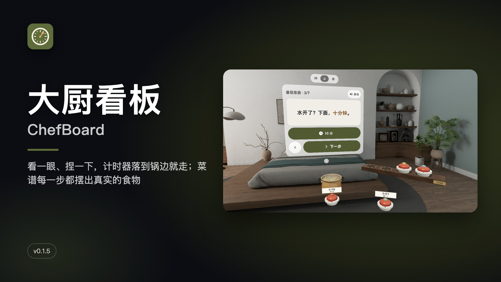
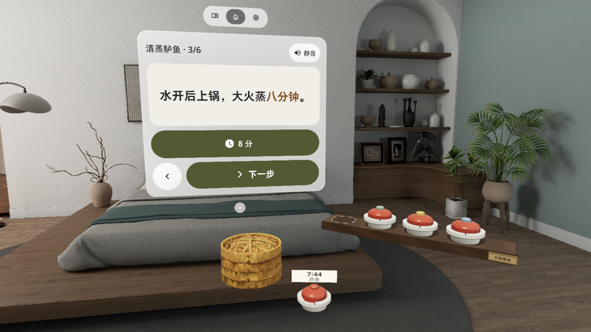
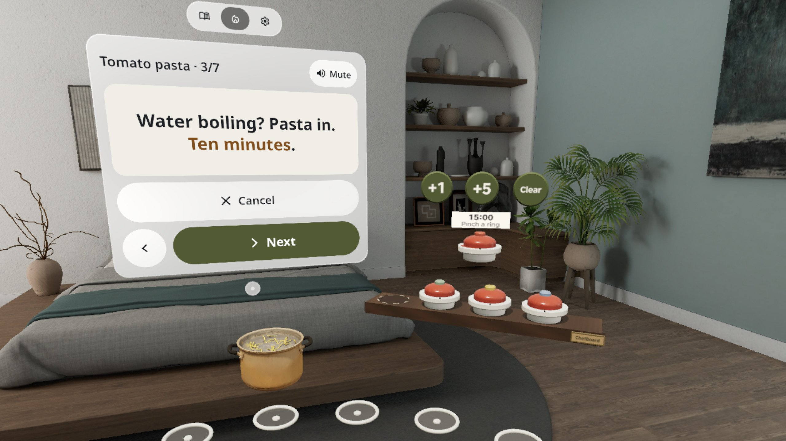
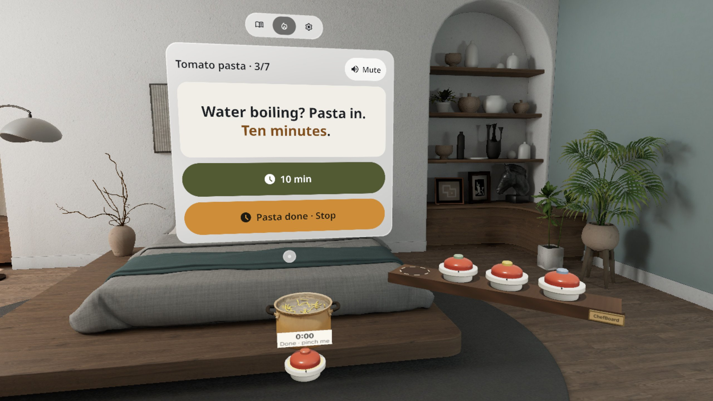
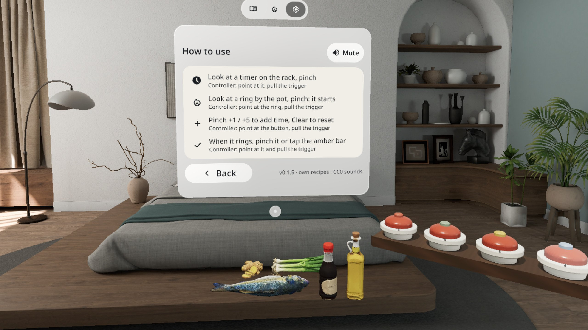

# 大厨看板 ChefBoard



[中文](#中文) · [English](#english)

## 中文

做菜时手上全是油和面粉，不想碰任何东西。大厨看板是 PICO OS 6 上的混合现实厨房计时器：灶台旁一块木架上放着四只陶瓷计时器，**看一眼、捏一下**，它就浮起来；再看锅边的一个圈、捏一下，它飞过去落在锅边开始走。到点它在锅边晃动、发亮、响铃，窗口底部的琥珀条一捏就停，不用转身。

- **每一步都有真实的食物**：8 道菜 53 页，每页都在台面上摆出这一步的 3D 食物（共 42 个模型）：备料页摆齐配料，「下面，十分钟」就是锅里的意面；换步时旧的淡出、新的淡入
- **只靠眼手**：注视 + 捏合，不用拖、不用拧；手柄扳机也行
- **计时器放到锅边**：五个圈排在灶台前，每只计时器在自己的位置响铃，几口锅同时开也分得清
- **步骤自带时间**：菜谱一屏一句；带时间的步骤直接给出「⏱ 10 分」，捏一下就拿起对应时长的计时器；浮起时可 +1 / +5 / 清零
- **贴一段文字就成菜谱**：粘贴自己的做法，自动拆成步骤并识别里面的时长
- v0.1.5 起 42 个食物模型都有颜色（铜锅、红珐琅锅、竹黄蒸笼、钴蓝盐碟、青花饭碗……），不再有白模
- 8 道内置菜谱，中英双语；设置里有「怎么操作」「叫回面前」「退出」；全部本机运行，不联网、不需要账号

| | |
|---|---|
|  |  |
| 「下面，十分钟」：锅里是意面，两只计时器在锅边走 | 备料页：六样配料摆在台面上 |
|  |  |
| 浮起 15:00，看个圈 · 捏一下；+1 / +5 / 清零 | 到点在锅边响，琥珀条「煮面好了 · 停」 |
|  |  |
| 清蒸鲈鱼「上锅蒸八分钟」：竹黄的蒸笼 | 菜谱页：菜名 + 时长 + 计时器个数 |
|  | |
| 设置里的「怎么操作」 | |

截图和 Release 里的演示视频都是在 PICO 模拟器里用调试命令驱动拍的，**非真实手势录像**。

### 安装

需要 PICO OS 6 设备（Spatial SDK 6.1.9，minSdk 35）。从 [Releases](https://github.com/kejing-dev/ChefBoard/releases) 下载 `ChefBoard-v0.1.5.apk`：

```
adb install -r ChefBoard-v0.1.5.apk
pico-cli app launch io.embodit.chefboard
```

Release 里的 APK 是 `./gradlew assembleRelease` 出的未签名包；要直接 `adb install`，先用自己的 key 签名，或从源码 `./gradlew :app:installDebug`。

### 从源码构建

```
./gradlew :app:assembleDebug :app:testDebugUnitTest
```

代码结构、调试广播和截图清单见 [AGENTS.md](AGENTS.md)；版本记录见 [CHANGELOG.md](CHANGELOG.md)。

## English

When you cook, your hands are covered in oil and flour. ChefBoard is a mixed-reality kitchen timer for PICO OS 6: four ceramic timers sit on a walnut rack beside the stove. **Look at one and pinch** and it floats up; look at a ring by a pot and pinch, and it flies there and starts. When time is up it shakes, glows and rings right by that pot, and one pinch on the amber bar in the window stops it — no turning round.

- **Real food on every step**: all 53 pages of the 8 recipes set that step's 3D food on the counter (42 models), from the full prep line to pasta in the pot; old food fades out as the new fades in
- **Eyes and pinch only**: gaze + pinch, no dragging or twisting; the controller trigger works too
- **Timers sit by the pot**: five rings in front of the stove; each timer rings at its own spot, so several pots never get mixed up
- **Steps carry their time**: one recipe sentence per screen; a timed step offers "⏱ 10 min" and one pinch picks up a timer with that time; +1 / +5 / Clear while it floats
- **Paste text, get a recipe**: paste your own method and it is split into steps with the times found
- Since v0.1.5 all 42 food models are in colour (copper pot, red enamel pot, golden bamboo steamer, cobalt salt dish, blue-and-white rice bowl…), no more white models
- 8 built-in recipes, Chinese and English; How to use, Bring back to front and Exit in Settings; fully offline, no account

| | |
|---|---|
|  |  |
|  |  |
|  |  |
|  | |

Screenshots and the demo video in the Release were captured in the PICO emulator, driven by debug commands — **not real hand-gesture footage**.

### Install

Needs a PICO OS 6 device (Spatial SDK 6.1.9, minSdk 35). Download `ChefBoard-v0.1.5.apk` from [Releases](https://github.com/kejing-dev/ChefBoard/releases):

```
adb install -r ChefBoard-v0.1.5.apk
pico-cli app launch io.embodit.chefboard
```

The Release APK is the unsigned `./gradlew assembleRelease` build; sign it with your own key before `adb install`, or build from source with `./gradlew :app:installDebug`.

### Build from source

```
./gradlew :app:assembleDebug :app:testDebugUnitTest
```

Structure, debug broadcast and screenshot list: [AGENTS.md](AGENTS.md); version history: [CHANGELOG.md](CHANGELOG.md).
